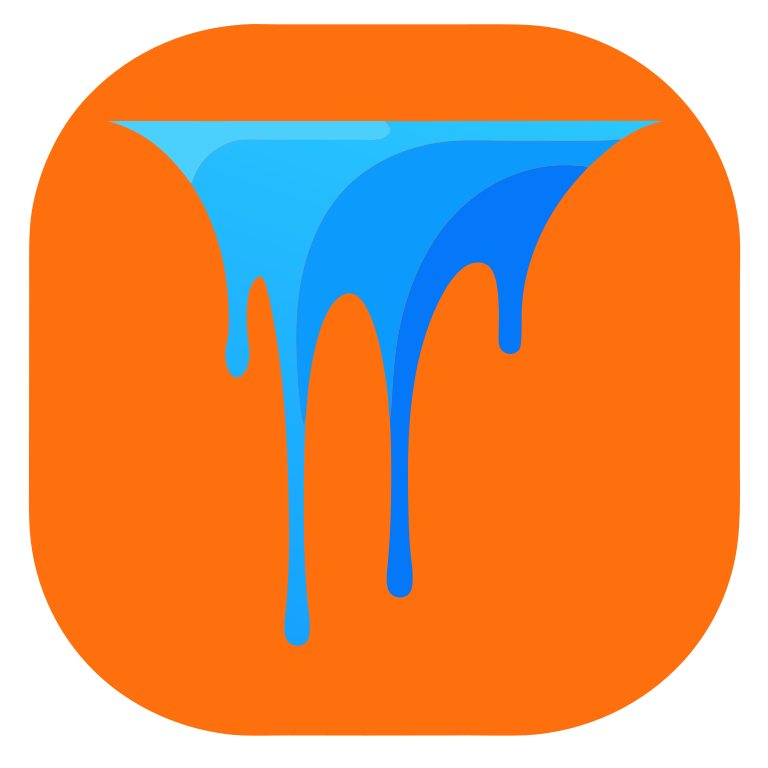

# Fusion Collection

  

Единое приложение сбора данных термического анализа в реальном времени (режимы ВТА и ДТА) и управления нагревом печи на базе модулей Advantech ADAM-4000.

## Возможности

- **Два режима работы стенда:**
  - **ВТА (визуально-термический анализ):** опрос термопары (`ADAM-4011`) и управление развёрткой нагрева печи (`ADAM-4021`) с защитным смещением `+0.001 В`;
  - **ДТА (дифференциальный термический анализ):** синхронный опрос двух модулей `ADAM-4011` (`#**` + `$AA4`, образец и эталон).
- **Постоянный мониторинг в реальном времени:** живые показания ЭДС, температуры, холодного спая (`$AA3`), частоты опроса и многоосевые графики `pyqtgraph` (с автоматической поддержкой светлой и тёмной системной темы) работают непрерывно с момента запуска программы.
- **Автообнаружение и верификация конфигурации модулей (`$AA2`):** автоматический поиск активного COM-порта и проверка настроек диапазона, формата данных и времени интегрирования (60 мс / 50 Гц) с диалогом подтверждения перенастройки.
- **Справочник термопар ГОСТ Р 8.585-2001 и редактор калибровок:** выбор типа термопары для каждого канала из 12 стандартов ГОСТ или пользовательских профилей, калибровка температуры по стандартным образцам со статистикой ($R^2$, $\text{SEC}$, $U = 2\cdot\text{SEC}$) и сохранение измерений в контейнер `.fus`.

## Требования и запуск

- Python >= 3.13, менеджер пакетов `uv`
- Установка окружения:
  `uv sync`
- Запуск из исходников:
  `.\run.cmd`
- Сборка исполняемого дистрибутива PyInstaller:
  `.\build.cmd`

## Документация и теоретические основы

Подробное руководство пользователя и теоретическое описание методов доступно в каталоге [`fusion_collection/docs/`](fusion_collection/docs/01_overview_and_modes.md) и внутри самой программы по клавише `F1` (**Справка → Руководство пользователя и теория**):
- [1. Назначение и режимы работы стенда (ВТА и ДТА)](fusion_collection/docs/01_overview_and_modes.md)
- [2. Модули ADAM-4000, протокол RS-485 и безопасность печи](fusion_collection/docs/02_hardware_adam.md)
- [3. Термометрия ГОСТ Р 8.585-2001 и компенсация холодного спая](fusion_collection/docs/03_thermometry_gost.md)
- [4. Калибровка температурной шкалы по реперам МТШ-90 / ICTAC](fusion_collection/docs/04_calibration_its90.md)
- [5. Проведение измерения, контроль скорости dT/dt и паспорт SCRAM](fusion_collection/docs/05_measurement_and_scram.md)

## Цитирование

Если вы используете **Fusion Collection** в научной работе, пожалуйста, процитируйте программу (метаданные приведены в файле [`CITATION.cff`](CITATION.cff)):

> *Yurev, I. O.* (2026). Fusion Collection [Computer software]. <https://doi.org/10.5281/zenodo.24275001>

## Лицензия

Проект распространяется на условиях лицензии **GNU General Public License v3.0 or later (`GPL-3.0-or-later`)** (см. [LICENSE.md](LICENSE.md), [LICENSE.ru.md](LICENSE.ru.md); официальная страница лицензии GNU GPL v3.0: [gnu.org/licenses/gpl-3.0.ru.html](https://www.gnu.org/licenses/gpl-3.0.ru.html)).
